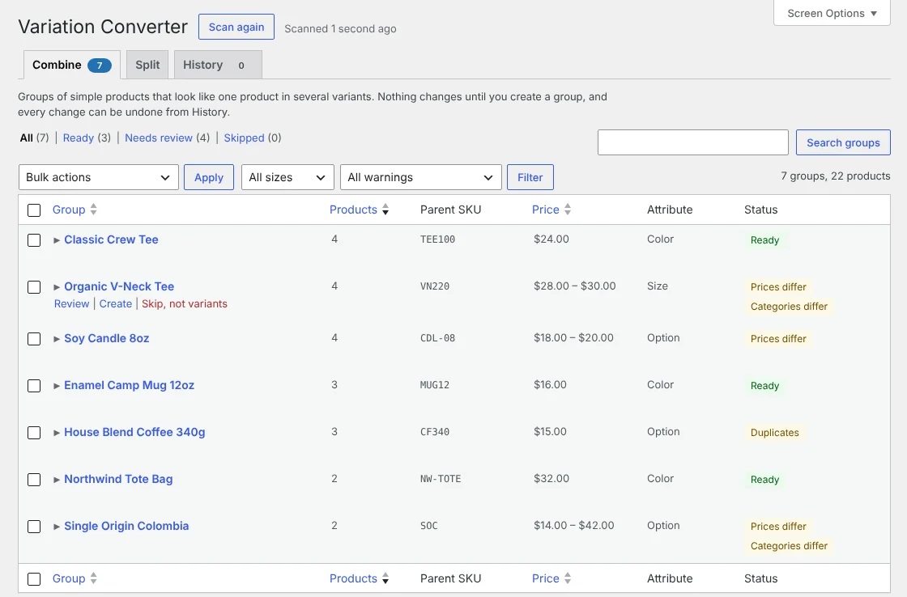
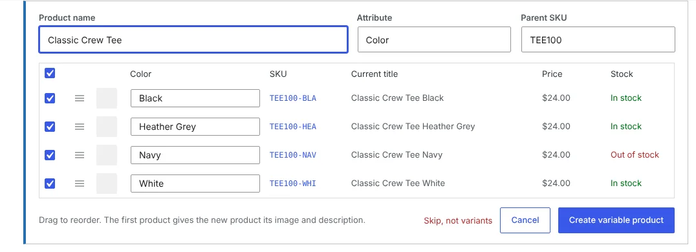
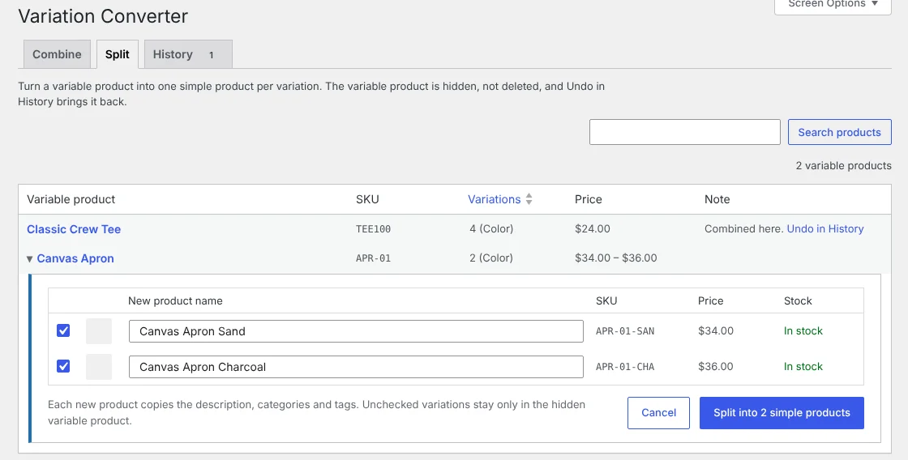
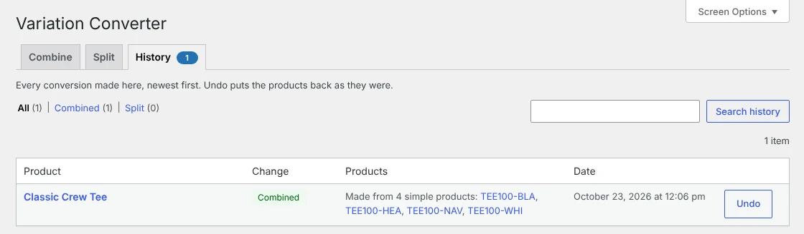

# Variation Converter for WooCommerce

Many stores list one simple product per color or size: "Tri-Rings Black", "Tri-Rings Blue", "Tri-Rings Red". Variation Converter finds those groups and turns each one you approve into a single variable product. It also works the other way, splitting a variable product into separate simple products.



**What it does**

- Scans your catalog and suggests groups of simple products that are variants of one product.
- Lets you check and edit each group before anything changes.
- Creates one variable product per group, with a variation for each original product.
- Splits a variable product into one simple product per variation.
- Hides the products it converts from. It never deletes them.
- Undoes any conversion in one click.
- Sends visitors of an old product page to the new variable product, with that option already selected.

## Requirements

- WordPress 6.5 or later
- WooCommerce 8.0 or later
- PHP 7.4 or later
- A user role that can manage WooCommerce, such as Shop Manager or Administrator

## Installation

1. Make sure WooCommerce is installed and active.
2. Get the plugin zip, `variation-converter-for-woocommerce.zip`, from the download button on the [project website](https://craigpestell.github.io/variation-converter/).
3. In WordPress, go to **Plugins > Add New > Upload Plugin**, upload the zip and activate it.

Take a database backup before converting many products at once. Undo is there, but a backup is good practice.

## Combine simple products into a variable product

1. Go to **Products > Variation Converter**. The **Combine** tab lists the groups the plugin found.
2. Click a group to open it.
3. Check the product name, the attribute (for example Color or Size), the parent SKU and the label of each variant ("Black", "Blue"). Untick any product that doesn't belong. Drag rows to change their order; the first product gives the new product its image and description.
4. Click **Create variable product**. If the group isn't really one product, click **Skip, not variants** so it stops appearing.



**Working through a long list.** The **Ready** view shows groups with no warnings. **Needs review** shows groups with a warning, such as different prices, different categories, missing or repeated labels, long labels, or two products with the same SKU. **Skipped** lists the groups you skipped; you can restore them. You can also search, filter by brand, group size or warning, and use **Bulk actions** to create or skip many groups at once.

**Combining products the plugin didn't group.** In **Products > All Products**, tick the products, choose **Combine into variable product** from the bulk actions, and click **Apply**. Their SKUs don't need to match.

**How groups are found.** Only published simple products that have a SKU and are shown in the catalog are scanned. Products without a SKU are never suggested. Products are grouped when:

- their SKUs belong to one family, such as `SE1421-01` and `SE1421-03`, and
- their names start with the same words. A brand name at the start doesn't count.

Whatever follows the shared words becomes the variant label. The plugin guesses the attribute (Color, Size, Flavor, Scent or Volume, otherwise Option); you can change it. Each variable product gets one attribute. Results are kept for 30 minutes, so click **Scan again** after you change products.

**What the new product gets.** Each variation takes its original's SKU, regular and sale price, sale dates, stock settings, weight, dimensions and image. The variable product takes the first product's descriptions, image, categories, tags, tax and shipping class, and adds the other products' images to its gallery. When the products are in different categories, you choose the new product's categories in the group. If WooCommerce fails to save any part, the partial product is removed.

**What happens to the originals.** They are hidden from your shop and search, not deleted. Past orders still point to them. Their old URLs redirect (301) to the variable product with that option selected. Reviews are not copied. Each SKU now exists twice, on the hidden original and on the variation, so that Undo can restore everything. Once you are sure you will keep the new product, you can delete the hidden originals yourself.

## Split a variable product into simple products

1. Go to **Products > Variation Converter** and open the **Split** tab, or click **Split into simple products** under a variable product in **Products > All Products**.
2. Each variation gets a row with a suggested name, such as "Tri-Rings Black". Edit the names, and untick variations you don't want as separate products.
3. Click **Split into N simple products**.



Each new product takes its variation's SKU, prices, sale dates, stock, weight, dimensions and image, plus the variable product's descriptions (a variation's own description wins if it has one), categories, tags, other attributes, tax status and purchase note. If a variation uses the variable product's shared stock count, the new product doesn't copy that count, so your stock isn't multiplied. The variable product is hidden, not deleted.

You can't split a variation set to "Any" for an attribute (for example "Any Size"). Give it a specific value first. A variable product that the plugin made by combining offers Undo instead of a split, so you get your original products back.

## Undo a conversion

Open the **History** tab. It lists every combine and split, newest first. Click **Undo** on a row.

- **Undoing a combine** deletes the variable product and its variations, and shows the original simple products again.
- **Undoing a split** deletes the new simple products and shows the variable product again.

Restored products get back the visibility they had before, plus the current prices and stock from the products being deleted, so sales made in the meantime carry over.

If customers have already ordered the product that Undo deletes, their orders keep the line items and totals, but those lines no longer link to a product. In that case it is usually better to keep the new product.



## Good to know

- There is no settings page.
- If you use Relevanssi, changed products are reindexed automatically. Other search plugins pick up the changes on their next reindex.
- Deleting the plugin removes its saved options and cached scan. Products it made, and the products it hid, stay as they are.

## WP-CLI

You can also combine and undo from the command line. There is no command for splitting.

```sh
wp variation-converter combine --all --dry-run   # list what would be created, with each group's key
wp variation-converter combine --all --min-size=3 --skip=price,cats
wp variation-converter combine 3f2a9c81d0e4      # create only the groups with these keys
wp variation-converter undo 1234                 # undo a combine or split by product ID
wp variation-converter undo --all --yes          # undo everything, without asking
```

`combine` options: `--limit=<n>` creates at most n groups; `--min-size=<n>` only takes groups of at least n products (default 2); `--skip` leaves out groups with these warnings: `dupes`, `label`, `long`, `price`, `cats`.

Groups are created as suggested, without products you unticked on the admin page. Groups with a missing or repeated label are skipped for you to fix on the admin page. If the suggested parent SKU is already in use, the product is created without one. Only one bulk run, from WP-CLI or the admin page, can create products at a time.

## For developers

- Filters: `varconv_scan_products` (leave products out of the scan), `varconv_brand_names` (brand names a product name can start with), `varconv_collections` (change the suggested groups) and `varconv_redirect_url` (change or turn off the old-URL redirect by returning `''`). Click **Scan again** after changing a scan filter.
- Build the plugin zip: `git archive --format=zip --prefix=variation-converter-for-woocommerce/ -o variation-converter-for-woocommerce.zip HEAD`
- Tests and a throwaway WordPress + WooCommerce test site: see [harness/README.md](harness/README.md).

## License

GPL-2.0-or-later. See [LICENSE](LICENSE).

Made by [Craig Pestell](https://craigpestell.com).
